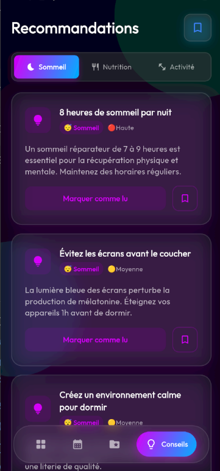
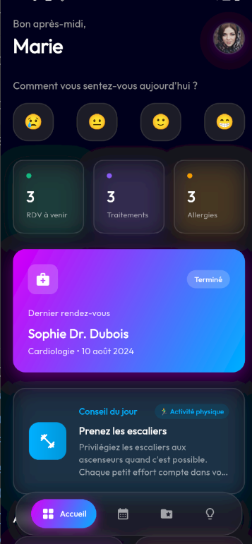
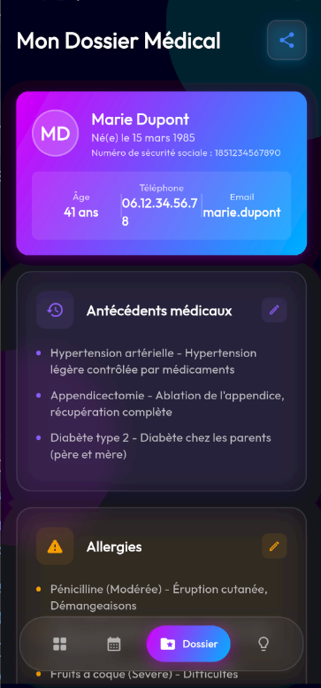
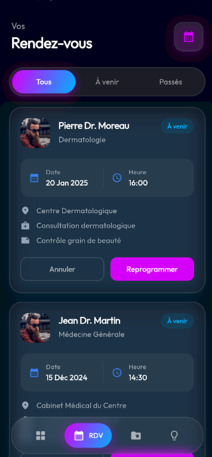

# patient_portal

Une application mobile Flutter permettant à un patient de consulter son carnet de suivi médical.

## 📱 Fonctionnalités

### 🏠 Écran d'accueil (/)

### 📅 Écran Rendez-vous (/rendez-vous)

### 🗂️ Écran Dossier (/dossier)

### 💡 Écran Recommandations (/recommandations)

## 🚀 Installation & Configuration Firebase

Ce projet utilise **Firebase Firestore** pour stocker les données. 

### 1. Prérequis
- Avoir un compte [Firebase](https://firebase.google.com/) et un projet créé.
- Avoir la base de données **Cloud Firestore** activée sur ce projet.
- Avoir installé la [Firebase CLI](https://firebase.google.com/docs/cli).

### 2. Configuration du projet
Dans votre terminal, à la racine du projet, exécutez :

```bash
# Connectez-vous à votre compte Google/Firebase
firebase login

# Installez l'outil FlutterFire en global
dart pub global activate flutterfire_cli

# Liez votre projet Flutter à votre projet Firebase
flutterfire configure
```
L'outil générera automatiquement le fichier `lib/firebase_options.dart` et les fichiers nécessaires pour Android/iOS (comme `google-services.json`).

### 3. Lancement et Synchronisation des données (Seed)

1. l'application affichera un écran d'erreur indiquant que les données sont introuvables.
2. Cliquez sur le bouton **"Seed Database"** (icône de nuage).
3. Le script intégré lira les fichiers `.json` du dossier `assets/` et peuplera automatiquement votre base de données Firestore !
5. Cliquez sur "Réessayer", vos données sont maintenant en ligne !

## Screenshots











